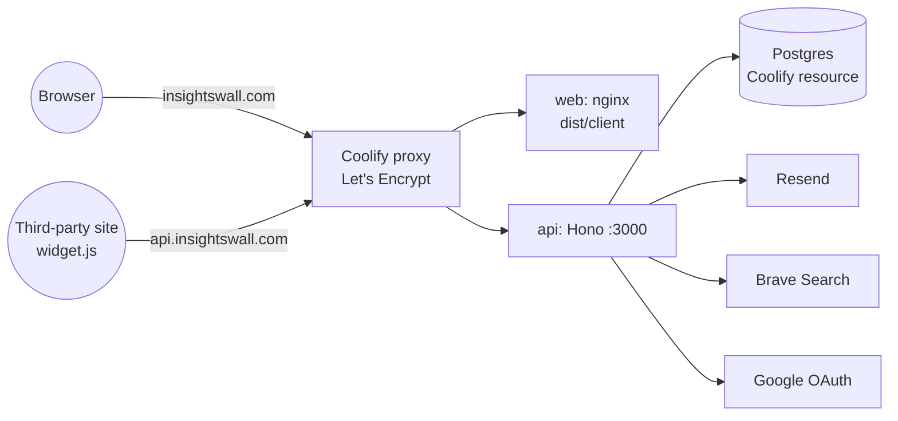
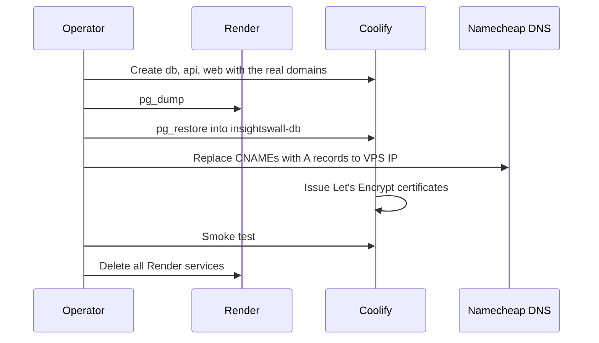

# Migration from Render to Coolify

InsightsWall runs on Render today and costs about 20 € per month. This spec moves the web, the API and the database to the Coolify server `xcanchal-apps` (Hetzner, `91.98.238.189`). The public URLs stay the same, so cookies, CORS, the Google OAuth redirect and the embedded `widget.js` need no change.

## Current and target state

| Part     | Domain                                     | Today (Render)                                  | Target (Coolify)                                |
| -------- | ------------------------------------------ | ----------------------------------------------- | ----------------------------------------------- |
| Web      | `insightswall.com`, `www.insightswall.com` | Static site, publish dir `apps/web/dist/client` | App from `apps/web/Dockerfile` (nginx)          |
| API      | `api.insightswall.com`                     | Web service, `npm run start`                    | App from `apps/api/Dockerfile` (Node 24)        |
| Database | —                                          | Render Postgres, Frankfurt                      | Coolify Postgres resource, `postgres:18-alpine` |
| DNS      | Namecheap                                  | CNAME to `*.onrender.com`                       | A records to the VPS IP                         |



## Coolify resources

| Resource           | Build                                      | Port                | Health check    | Notes                                                                             |
| ------------------ | ------------------------------------------ | ------------------- | --------------- | --------------------------------------------------------------------------------- |
| `insightswall-db`  | `postgres:18-alpine`                       | 5432, internal only | Coolify default | No public port. Daily Coolify backup.                                             |
| `insightswall-api` | `apps/api/Dockerfile`, context = repo root | 3000                | `GET /health`   | Auto-deploy from `main`.                                                          |
| `insightswall-web` | `apps/web/Dockerfile`, context = repo root | 80                  | `GET /`         | `VITE_*` values are build args. `www` redirects to apex. Auto-deploy from `main`. |

Both Dockerfiles build from the repo root because the apps depend on the `@app/types` workspace.

## Environment variables

| Variable                                                                                      | App | Kind            | Production value                         |
| --------------------------------------------------------------------------------------------- | --- | --------------- | ---------------------------------------- |
| `NODE_ENV`                                                                                    | api | runtime         | `production`                             |
| `PORT`                                                                                        | api | runtime         | `3000`                                   |
| `DATABASE_URL`                                                                                | api | runtime, secret | Internal URL of `insightswall-db`        |
| `FRONTEND_URL`                                                                                | api | runtime         | `https://insightswall.com`               |
| `BETTER_AUTH_URL`                                                                             | api | runtime         | `https://api.insightswall.com`           |
| `BETTER_AUTH_SECRET`                                                                          | api | runtime, secret | New value from `openssl rand -base64 32` |
| `GOOGLE_CLIENT_ID`, `GOOGLE_CLIENT_SECRET`                                                    | api | runtime, secret | Copy from Render                         |
| `RESEND_API_KEY`, `EMAIL_FROM`                                                                | api | runtime, secret | Copy from Render                         |
| `BRAVE_SEARCH_API_KEY`, `BRAVE_SEARCH_FRESHNESS`, `BRAVE_SEARCH_COUNTRY`, `BRAVE_SEARCH_LANG` | api | runtime         | Copy from Render                         |
| `VITE_API_URL`                                                                                | web | build arg       | `https://api.insightswall.com`           |
| `VITE_BETTER_AUTH_URL`                                                                        | web | build arg       | `https://api.insightswall.com`           |

## nginx routing for the web app

The rules copy the current Render static-site rewrites. Unknown marketing URLs must stay real 404 responses.

| Request path                                                | Response                                                       |
| ----------------------------------------------------------- | -------------------------------------------------------------- |
| `/auth/*`, `/projects`, `/account`, `/project/*`            | `/_shell.html`, status 200                                     |
| Path that matches a prerendered file or `<path>/index.html` | That file, status 200                                          |
| Hashed assets under `/assets/`                              | File with `Cache-Control: public, max-age=31536000, immutable` |
| Any other path                                              | nginx 404                                                      |

## Cutover sequence

Only the owner uses the app, so downtime is acceptable and no rehearsal is needed.



Data copy commands:

```bash
pg_dump --format=custom --no-owner --no-acl "$RENDER_EXTERNAL_DATABASE_URL" -f insightswall.dump
pg_restore --clean --if-exists --no-owner --no-acl -d "$COOLIFY_DATABASE_URL" insightswall.dump
```

The dump includes the `drizzle` migrations table. New migrations stay a manual step: `npm run db:migrate --workspace=@app/api` with the production `DATABASE_URL`, because `drizzle-kit` is a dev dependency and is not in the API image.

## Smoke test

| Check                                     | Pass condition                              |
| ----------------------------------------- | ------------------------------------------- |
| `GET https://api.insightswall.com/health` | `{"status":"ok"}`                           |
| `https://insightswall.com/` and `/about`  | Prerendered HTML, valid TLS                 |
| `https://www.insightswall.com/`           | Redirect to apex                            |
| Reload on `/projects`                     | App loads, no 404                           |
| Unknown marketing URL                     | Status 404                                  |
| Email sign-in                             | Email arrives through Resend                |
| Google sign-in                            | Callback returns to the app, user signed in |
| Widget on a test page                     | Loads and submits feedback                  |

## Rollback

Keep `insightswall.dump` until the smoke test passes. If Coolify fails, restore the CNAMEs to Render before deleting the Render services.

## Code changes

| File                  | Change                                                                                                                                   |
| --------------------- | ---------------------------------------------------------------------------------------------------------------------------------------- |
| `apps/api/Dockerfile` | Multi-stage build: build `@app/types` and `@app/api`, install production dependencies only, run `node dist/src/index.js` as user `node`. |
| `apps/web/Dockerfile` | Stage 1 builds `@app/web` with `VITE_*` build args. Stage 2 is nginx with `dist/client`.                                                 |
| `apps/web/nginx.conf` | Rules from the routing table above.                                                                                                      |
| `.dockerignore`       | Exclude `node_modules`, `dist`, `.env*`, test output.                                                                                    |
| `README.md`           | Replace the Render sections with Coolify deployment notes.                                                                               |
